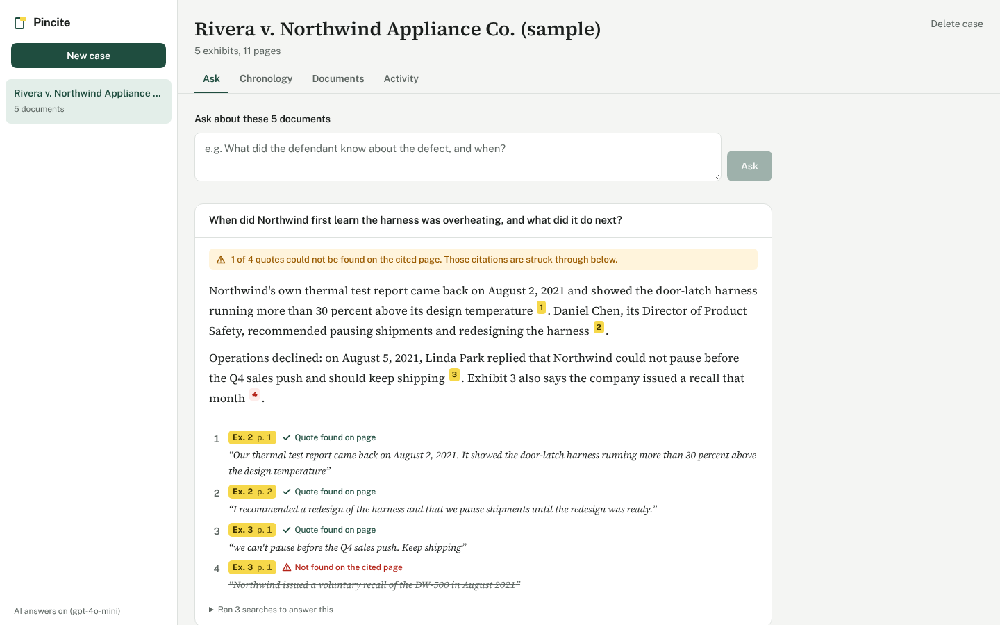
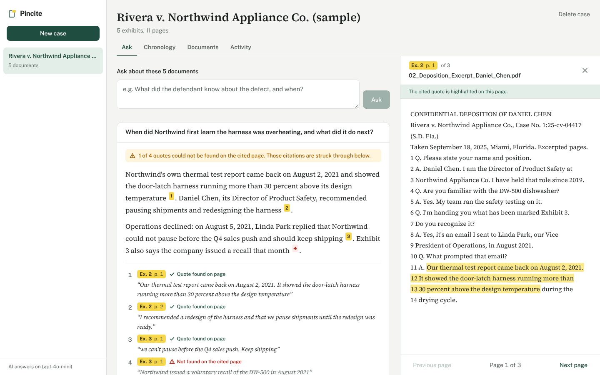
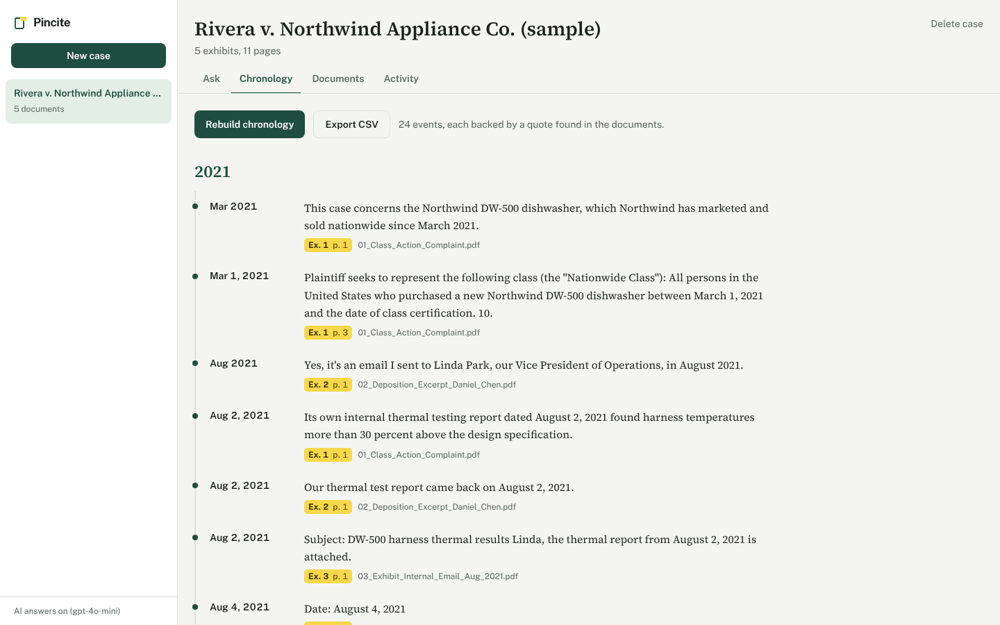

# Pincite

Ask questions of a case file and get answers where every quote is checked against the page it came from.

*A pin cite is a citation to the exact page where a statement appears. That's what every answer here comes with.*

**Live demo:** https://pincite.onrender.com (access code on request; the free instance takes about a minute to wake up)

Pincite is an AI research assistant for litigation documents. Add a case's PDFs (complaints, deposition transcripts, exhibits, scanned records) and it will:

- **Answer questions with checked citations.** A tool-calling agent searches the case, answers in plain English, and cites exhibit, page and exact quote. The application then verifies each quote against the stored page text and strikes through any it can't find.
- **Build a chronology.** Every dated event across all exhibits, sorted, each linked to its page. Events whose quotes can't be verified are dropped and counted. Export to CSV.
- **Read scans.** Pages without a text layer go through OCR (Tesseract).
- **Redact before storing.** Social Security, card, account, routing and phone numbers and emails are removed at ingest, so the database, search index and model never see them.
- **Keep an audit trail** of every upload, question and export.



*The sample case, answered by a scripted demo model. Citation 4 is deliberately fabricated to show how a failed check looks.*

| Click a citation: the page opens with the quote highlighted | Chronology built from all five exhibits |
| --- | --- |
|  |  |

## Who decides what

| | Decides |
| --- | --- |
| **Model** | What to search for, what the documents say, which passages support each statement |
| **Application code** | What text the model may see (redacted, fenced as data), running searches, whether each quote really exists on the cited page, what gets logged |
| **Attorney** | Whether a verified quote actually supports the statement, by reading it highlighted in context |

A plain-English version for non-technical users is in [docs/for-attorneys.md](docs/for-attorneys.md).

## Architecture

```
          PDF upload
              │
   ┌──────────▼──────────┐   pdfplumber text layer; Tesseract OCR for scanned pages
   │ extract → redact →  │   SSN / card (Luhn) / account / phone / email removed here
   │ chunk → embed       │   ~900-char overlapping chunks, embeddings (optional)
   └──────────┬──────────┘
              ▼
        SQLite: cases · documents · pages · chunks · events · audit
              │
   ┌──────────▼──────────┐
   │ hybrid search       │   BM25 + cosine similarity, reciprocal rank fusion
   └──────────┬──────────┘
              ▼
   ┌─────────────────────┐   tools: search_documents(query, exhibit_no)
   │ agent loop (≤4 steps)│  output: strict JSON schema {answer, found, citations[]}
   └──────────┬──────────┘   excerpts fenced as data → prompt-injection resistant
              ▼
   ┌─────────────────────┐
   │ quote verification  │   every quote matched against the cited page's stored text
   └──────────┬──────────┘
              ▼
   FastAPI JSON API  ←→  Next.js UI (static export, served by the same container)
```

| Path | What's there |
| --- | --- |
| `backend/app/agent.py` | Tool-calling agent, prompt, answer schema, citation checks |
| `backend/app/verify.py` | Quote verification (normalization, elisions, transcript line numbers) |
| `backend/app/search.py` | BM25, embedding search, rank fusion |
| `backend/app/ingest.py` | Extraction, OCR fallback, chunking, embeddings |
| `backend/app/redact.py` | Sensitive-identifier redaction |
| `backend/app/chronology.py` | AI and pattern-based event extraction |
| `backend/evals/` | Golden questions and the eval runner |
| `backend/sample_data/` | Generator for the fictional sample case |
| `frontend/components/` | Ask, chronology, documents, activity, page viewer |
| `docs/decisions/` | Why it's built this way |

## AI providers

Pincite talks to models through the OpenAI SDK, so it works with:

- **Google Gemini (free tier)**: set `GEMINI_API_KEY`. Uses `gemini-3.5-flash-lite` through Gemini's OpenAI-compatible endpoint, with keyword search only to save the free daily quota.
- **OpenAI**: set `OPENAI_API_KEY`. Uses `gpt-4o-mini` with strict structured outputs and hybrid keyword + embedding search.

If a provider rejects the strict JSON schema, Pincite retries in plain JSON mode with the schema in the prompt. Either way, citations are checked by code, not trusted from the model. Rate limits and bad keys come back as clear messages, not crashes.

## Run it locally

```bash
# backend (Python 3.12, plus tesseract-ocr from your package manager)
cd backend
python -m venv .venv && source .venv/bin/activate
pip install -r requirements-dev.txt
cp .env.example .env             # add a GEMINI_API_KEY (free) or OPENAI_API_KEY, or neither to run without AI
uvicorn app.main:app --reload    # http://localhost:8000/docs

# frontend
cd frontend
npm install
npm run dev                      # http://localhost:3000
```

Click **Open the sample case** to load five fictional exhibits: a class action complaint, a deposition excerpt, an internal email with a planted prompt injection, a warranty claim full of personal data, and a scanned fire report.

Without an API key, everything except AI answers still works: search returns the best passages, and the chronology uses a deterministic date extractor.

## Tests and evals

```bash
cd backend
python -m pytest                        # 26 tests, offline, uses a scripted fake model
python -m evals.run --mode retrieval    # offline: is the right page in the top 6? (CI gate: 90%)
python -m evals.run --mode full         # needs an API key: grades real answers
```

The golden set has 19 questions: 14 answerable, 1 prompt-injection probe, and 4 the documents can't answer (including a request for the redacted SSN). Full mode reports:

- **Pass rate:** verified answer, correct page cited, key facts present
- **Groundedness:** share of citations whose quote was found on the page
- **Refusal rate:** "not found" on unanswerable questions

Current offline retrieval result: **Recall@6 = 100%, MRR = 0.81**.

CI runs the tests, the retrieval gate, lint and build, then builds the Docker image and smoke-tests the container.

## Quick deploy (free)

[](https://render.com/deploy?repo=https://github.com/charanreddy9866/Pincite)

Render builds the same container from `render.yaml` and asks for a free `GEMINI_API_KEY` (from [Google AI Studio](https://aistudio.google.com/apikey), no card needed) and an `ACCESS_CODE`. One URL serves both the UI and the API. The free tier sleeps when idle, so the first visit takes about a minute.

## Deploy to Google Cloud Run

```bash
gcloud auth login
gcloud config set project YOUR_PROJECT_ID
./deploy/cloudrun.sh
```

The script:

1. Enables Cloud Run, Cloud Build, Artifact Registry and Secret Manager.
2. Stores your Gemini key (or OpenAI key with `PROVIDER=openai`) and an access code in Secret Manager.
3. Builds the single container from source and deploys it, capped at one instance.

There's also a manual GitHub Actions workflow (`deploy.yml`) using Workload Identity Federation, so no service-account keys live in GitHub.

The demo deployment keeps data in SQLite on the instance (see [decision 4](docs/decisions/0004-single-container-on-cloud-run.md)). For real case data it should move to:

- Cloud SQL with pgvector
- Cloud Storage with customer-managed keys
- SSO instead of a shared code

## Design decisions

1. [Citations are verified by code, not trusted from the model](docs/decisions/0001-verify-citations-in-code.md)
2. [Sensitive identifiers are redacted once, at ingest](docs/decisions/0002-redact-at-ingest.md)
3. [Hybrid retrieval with rank fusion](docs/decisions/0003-hybrid-retrieval.md)
4. [One container on Cloud Run](docs/decisions/0004-single-container-on-cloud-run.md)
5. [Tests run without a model; quality is measured with evals](docs/decisions/0005-test-without-a-model.md)

---

All names, companies, case numbers and identifiers in the sample data are fictional.

Built by [Charan Reddy Katta](https://github.com/charanreddy9866).
